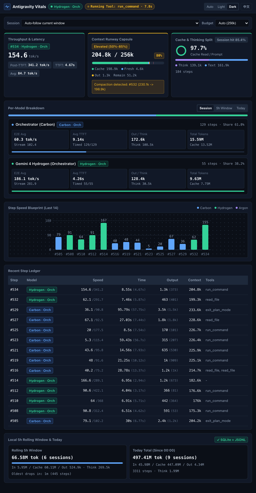

# Antigravity Vitals

**Zero-patch, zero-dependency Native Antigravity 2.0 Sidecar UI Plugin (`v0.2.0`)** for real-time per-model throughput (`tok/s`), TTFT latency, context runway, cache efficiency, and local 5-hour / daily token telemetry.

> Designed to keep `/Applications/Antigravity.app` (and `app.asar`) completely untouched — preserving official code signatures and auto-updates. All metrics are parsed in read-only mode from local `transcript.jsonl` logs and `conversations/<id>.db` (`gen_metadata` SQLite + built-in pure-JS Protobuf decoder).

<p align="center">
  <picture>
    <source media="(prefers-color-scheme: dark)" srcset="./docs/vitals-dark.png">
    <source media="(prefers-color-scheme: light)" srcset="./docs/vitals-light.png">
    
  </picture>
</p>

## Why Antigravity Vitals?

- **Zero Client Modification**: Runs strictly as a native Antigravity 2.0 Sidecar UI plugin inside `~/.gemini/config/plugins/antigravity-vitals`, never patching `app.asar` or breaking macOS/Windows code signatures and automatic updates.
- **Zero External Dependencies**: Uses Node.js built-in modules (`node:sqlite`, `node:http`, `node:test`) and a custom pure-JS Protobuf wire decoder — no `node_modules` required.
- **Read-Only & Local-First**: Reads local session logs and SQLite metadata (`readOnly: true`) with incremental `mtime`/`size` caching; sends zero network telemetry anywhere.

## Key Features

- **Per-Model Breakdown (`byModel`)**: Identifies the model used at each step (e.g., `Orchestrator (Carbon)`, `Gemini 4 Carbon (High / Medium)`, `Gemini 4 Argon`, `Gemini 4 Hydrogen`, `Gemini Flash`) across **Session**, **5h Window**, and **Today** scopes, comparing step share, end-to-end vs. post-TTFT streaming `tok/s`, average TTFT, thinking tokens, and cache reads.
- **Real-Time Throughput, TTFT & Activity Stopwatch**: Live status pill (`Idle` / `Generating` / `Running Tool` with a `200ms` stopwatch), last-step speed, post-TTFT streaming throughput, TTFT latency, and session average `tok/s`.
- **Multi-Segment Context Runway**: Auto-detects the host context budget (`auto` mode from `gen_metadata`), visualizes **Cache Read / Fresh Input / Output** segments with `50%` and `85%` markers, alerts when `>= 85%`, and logs `CHECKPOINT` auto-compaction drops.
- **Cache Efficiency Ring & Thinking Split**: Displays prompt cache read ratio for both the latest step and full session alongside a thinking-token vs. response-text breakdown bar.
- **Blueprint Step Chart & Recent Step Ledger**: Interactive SVG step speed chart (last 14 planner steps color-coded by model family) and per-step ledger table (`Speed`, `Time (TTFT)`, `Output (Think)`, `Context`, `Tools`).
- **Local 5h Rolling Window & Today Totals**: Tracks total tokens across local sessions in the past 5 hours (with countdown until the oldest step drops out of the window) and cumulative usage since local `00:00`.
- **Adaptive Engineering UI**: GitHub Primer (light) and Linear (dark) themes with automatic/manual switching and an English / Chinese UI language toggle.

## Requirements

- **Node.js `>= 22.5.0`** (uses built-in `node:sqlite`).
- **Google Antigravity 2.0** desktop client.

## Installation

```bash
git clone https://github.com/foclgithub/antigravity-vitals.git
cd antigravity-vitals

# 1. Verify unit tests pass
npm test

# 2. Install/sync plugin to ~/.gemini/config/plugins/antigravity-vitals
npm run sync
```

Reload Antigravity IDE after syncing, then open **Vitals** from the auxiliary side pane (or navigate to `sidecar://antigravity-vitals/vitals/`).

## CLI & Standalone Preview

You can also inspect telemetry directly from the terminal or launch a standalone `127.0.0.1` web preview:

```bash
# Print telemetry summary (and per-model tables) for the active or latest conversation
node cli.mjs

# Query a specific conversation in JSON format
node cli.mjs --conv <conversation-id> --json

# Launch standalone browser dashboard on 127.0.0.1
node cli.mjs --serve 0
```

## License

[MIT](./LICENSE)
